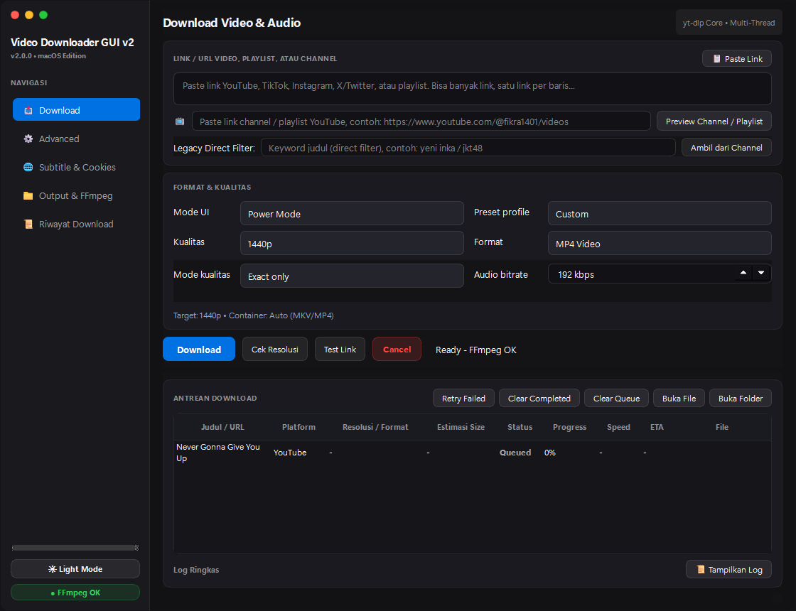
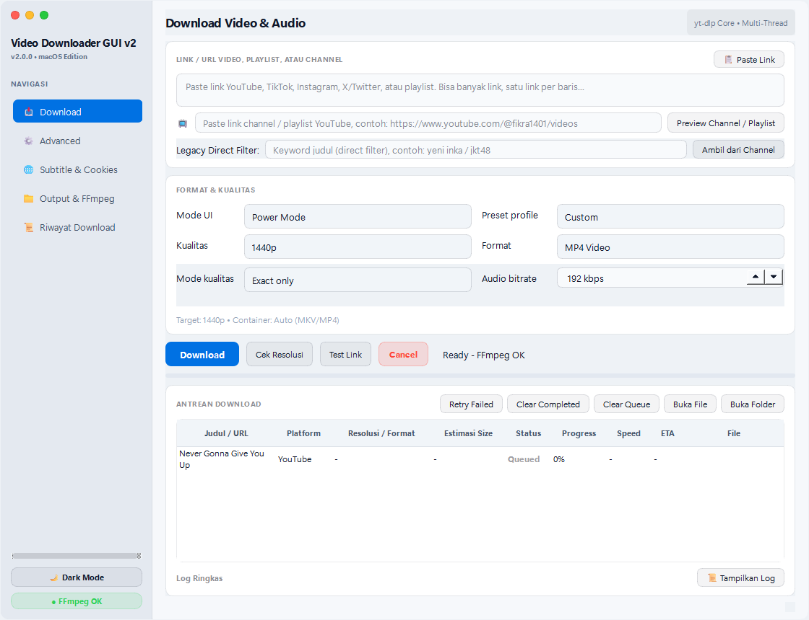

# TarikYT

**TarikYT** (`tarikyt`) adalah aplikasi desktop **Video & Audio Downloader** berbasis **Python (PySide6)** dan **yt-dlp** dengan antarmuka modern bergaya **macOS** (*frameless rounded window*, *traffic lights*, sidebar navigasi, Cupertino inset cards, serta dukungan **Dark Mode & Light Mode**).

## Tampilan Aplikasi

| Dark Mode | Light Mode |
| --- | --- |
|  |  |

---

## Fitur Utama

- **Tampilan macOS Desktop Modern**
  - Jendela *frameless* dengan tombol kontrol 🔴 🟡 🟢 yang berfungsi penuh, drag header, dan *resize grip*.
  - **Dual-Theme (Dark Mode & Light Mode)** yang tersimpan otomatis.
  - Dua mode antarmuka: **Simple Mode** (ringkas & cepat) dan **Power Mode** (kontrol lengkap kualitas, preset, bitrate, dan filter).
- **Multi-Platform & Kualitas Tinggi**
  - Mendukung YouTube, TikTok, Instagram, X/Twitter, dan berbagai situs lain yang didukung `yt-dlp`.
  - Mendukung resolusi hingga **4K / 8K** dengan *auto-merge* video + audio melalui **FFmpeg**.
  - Ekstraksi audio (MP3, M4A, WAV, FLAC, Opus) dengan pengaturan bitrate.
- **Channel & Playlist Preview Selektif**
  - Pindai daftar video dari channel atau playlist lengkap dengan pencarian, filter, pratinjau thumbnail, dan pemilihan selektif sebelum masuk antrean.
- **Alur Kerja & Mesin yang Andal**
  - **Multi-thread download queue** dengan status real-time, *progress bar*, kecepatan, dan estimasi ukuran.
  - **Smart Error Hints**: otomatis memberi saran solusi saat terjadi error umum (seperti YouTube bot check / HTTP 403, FFmpeg belum terdeteksi, atau gangguan jaringan).
  - **Non-blocking `yt-dlp` Updater** di background agar UI tetap responsif.
  - **Shortcut Keyboard**: `Ctrl + Enter` untuk mulai download, `Delete` untuk menghapus item terpilih dari antrean.
  - **Riwayat Download** dengan pencarian, filter, *open file/folder*, dan *re-download*.

---

## Prasyarat

- **Python 3.10+**
- **FFmpeg** (disarankan tersedia di `PATH` sistem, atau arahkan path `ffmpeg.exe` dari tab **Output / FFmpeg** di dalam aplikasi).

---

## Cara Instalasi & Menjalankan dari Source

1. **Clone repository:**
   ```bash
   git clone https://github.com/<username>/tarikyt.git
   cd tarikyt
   ```

2. **Buat virtual environment (opsional, disarankan):**
   ```bash
   python -m venv .venv
   # Windows PowerShell:
   .\.venv\Scripts\Activate.ps1
   ```

3. **Install dependensi:**
   ```bash
   pip install -r requirements.txt
   ```

4. **Jalankan aplikasi:**
   ```bash
   python main.py
   ```

---

## Build ke Windows Executable (`.exe`)

Proyek ini sudah dilengkapi konfigurasi PyInstaller:

```powershell
.\build_v2.ps1
```

Hasil build akan tersimpan di folder `dist/`.

---

## Menjalankan Pengujian (Unit Tests)

```bash
python -m unittest test_phase1_features.py test_channel_preview.py
```

---

## Catatan Privasi & Disclaimer

- File riwayat (`*_history.jsonl`), pengaturan (`*_settings.json`), state (`*_state.json`), dan `cookies.txt` bersifat lokal dan sudah dikecualikan melalui `.gitignore`.
- Aplikasi ini ditujukan untuk **penggunaan pribadi** (seperti mengarsipkan konten milik sendiri atau media berlisensi bebas). Harap patuhi hak cipta serta *Terms of Service* masing-masing platform.
